<div align="center">

# RIKE 理科学习辅助系统

**面向高中物理、化学、生物的在线题库与学习辅助平台**

学生按知识点练习、即时判分、错题复盘；教师在自己的任课范围内组卷、发布、看学情；管理员统一维护账号、班级与题库。<br/>
AI 只负责讲解、答疑与候选题生成，**正式判分与标准解析始终由人工审核过的题库决定**。

[](https://github.com/Fiesty-Abyss/rike-tiku/actions/workflows/ci.yml)
[](https://github.com/Fiesty-Abyss/rike-tiku/releases)
[](LICENSE)


[快速开始](#快速开始) · [功能一览](#功能一览) · [系统架构](#系统架构) · [演示账号](#演示账号) · [文档](docs/README.md) · [更新日志](CHANGELOG.md)

</div>

<p align="center">
  
</p>

| 学生：三科工作台 | 学生：练习结果与标准解析 | 教师：任课工作台 |
|:---:|:---:|:---:|
| 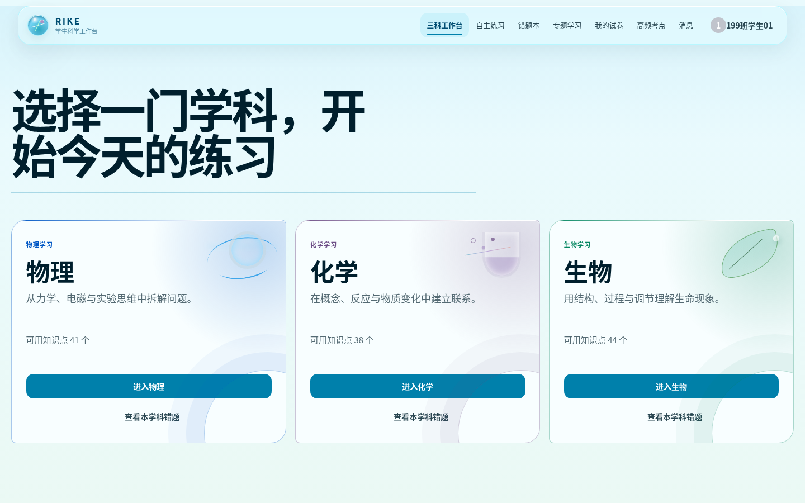 | 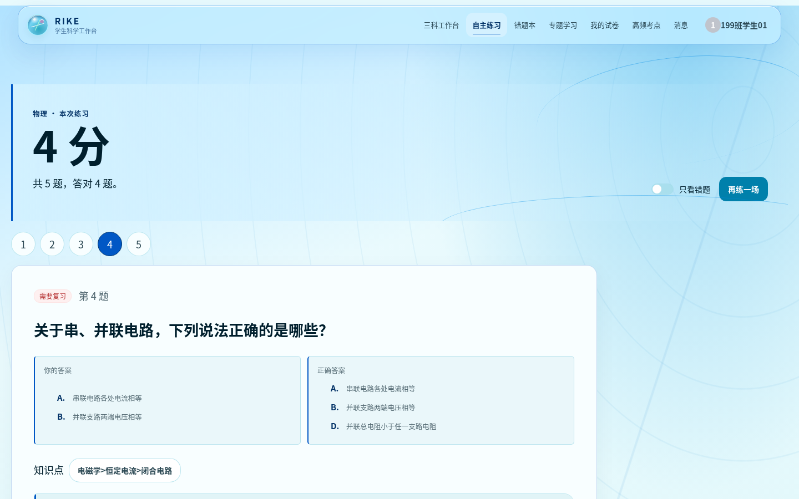 | 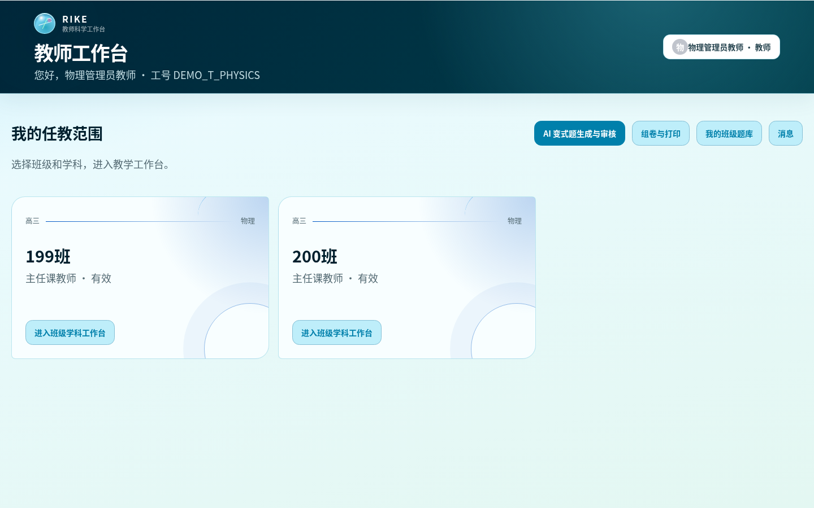 |
| **管理员：系统总览** | **管理员：题库审核发布** | **管理员：AI 模型管理** |
| 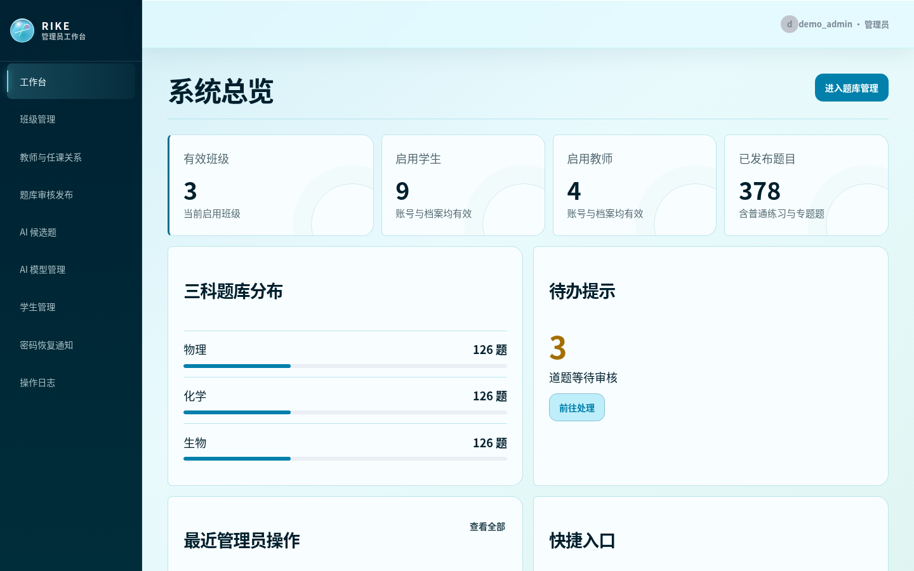 | 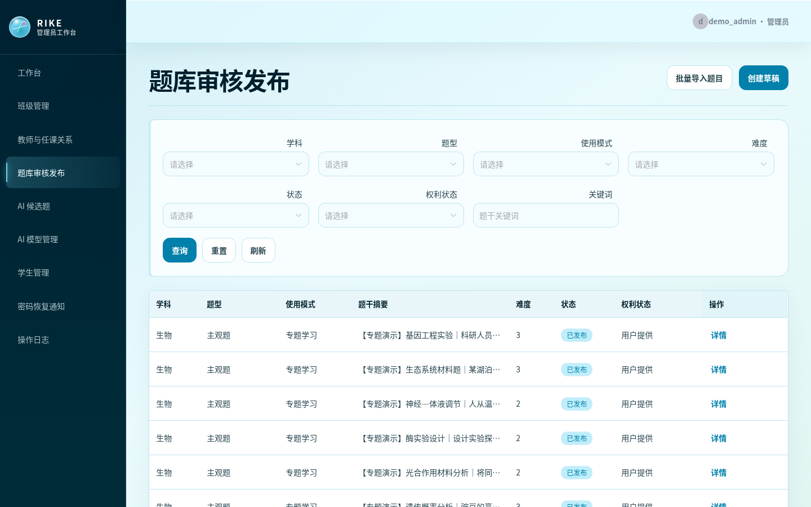 | 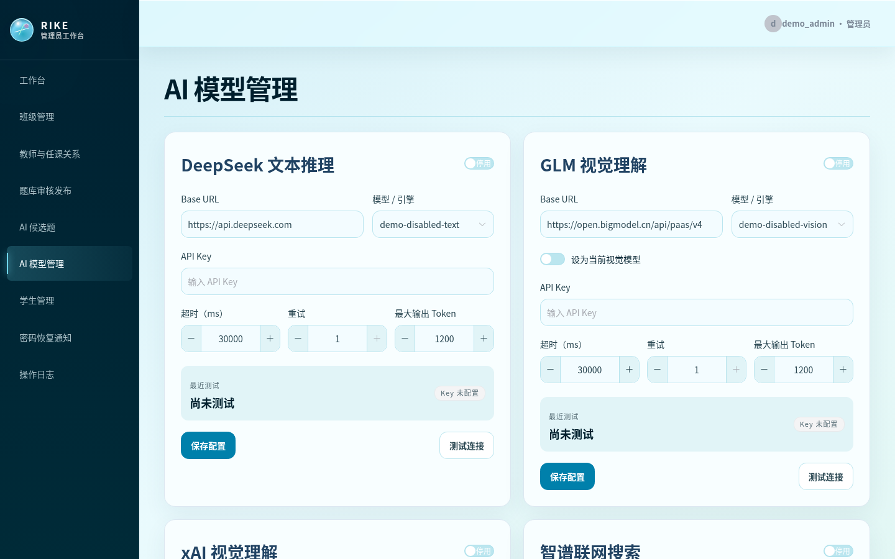 |

> 以上均为本地演示环境（`rike_tiku_demo`）的实机截图，数据为项目自编演示数据。

## 亮点

- 🎯 **判分可信**：客观题按人工审核过的标准答案确定性判分，填空题只接受显式列出的等价答案；AI 输出永远不会改写成绩或 STANDARD 解析。
- 🔐 **权限清晰**：教师的一切数据访问都由服务端按“教师—班级—科目”三元任课关系校验；多角色账号登录时显式选择本次角色。
- 🧪 **为理科而生**：KaTeX + mhchem 渲染公式与化学式，题干 / 解析图片附件受控存储，结果页展示作答时冻结的选项快照。
- 🔁 **学习闭环**：练习 → 判分 → 标准解析 → 错题本筛选 / 再做 / 归档 → 知识点掌握度 → 规则推荐，再加专题单元与高频考点卡片。
- 🤖 **受控 AI**：当前题答疑、错因分析、变式练习、候选题生成；支持 DeepSeek 文本与 GLM / xAI 视觉模型，候选题必须人工审核后才进入题库。
- 🧾 **可审计**：管理员高风险操作写入操作日志并可检索；导入走 Preview → Confirm 两步，题目统一经过 PENDING → 审核 → 发布。
- 🛠 **工程完整**：Flyway V1–V30 管理 50 张业务表，后端 227 项、前端 231 项自动化测试，CI 覆盖构建与测试。

## 功能一览

### 学生

| 功能 | 说明 |
|---|---|
| 三科工作台 | 物理 / 化学 / 生物分学科入口，显示可用知识点与掌握情况 |
| 自主练习 | 按学科、知识点、题型、难度组卷练习，提交后即时判分 |
| 结果与标准解析 | 逐题对比“你的答案 / 正确答案”，展示冻结选项与分段 STANDARD 解析 |
| 错题本 | 按学科、知识点、题型、时间筛选，支持再做与软归档 |
| 专题学习 | 15 个综合题专题单元，按基础 / 迁移 / 进阶编排，可保存主观作答 |
| 我的试卷 | 在线完成教师发布的试卷，草稿自动保存，提交后查看客观题得分 |
| 高频考点 | 物理、化学、生物知识卡片：核心知识、公式、适用条件、二级结论、常见误区 |
| AI 学习辅助 | 当前题答疑、错因分析、变式练习（需管理员启用 AI 模型） |
| 私信 / 个人中心 | 与任课教师私信（支持撤回与仅本人删除），维护简介、头像与密码 |

<table><tr>
<td>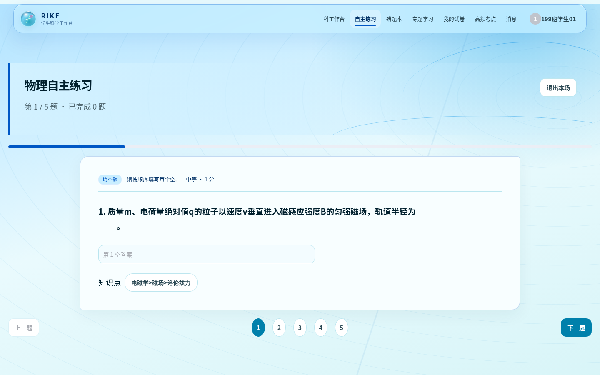</td>
<td>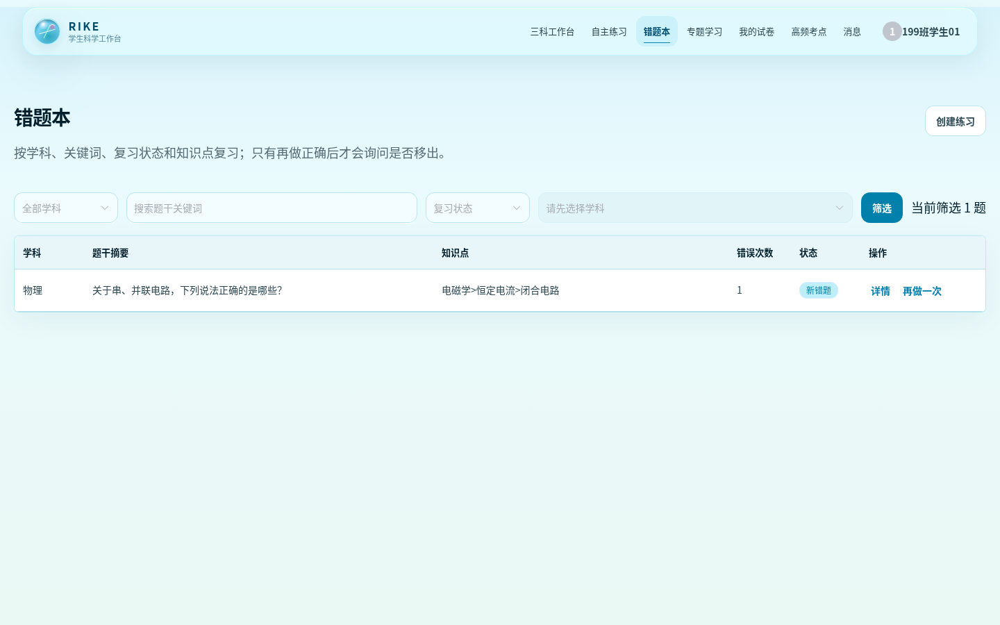</td>
<td>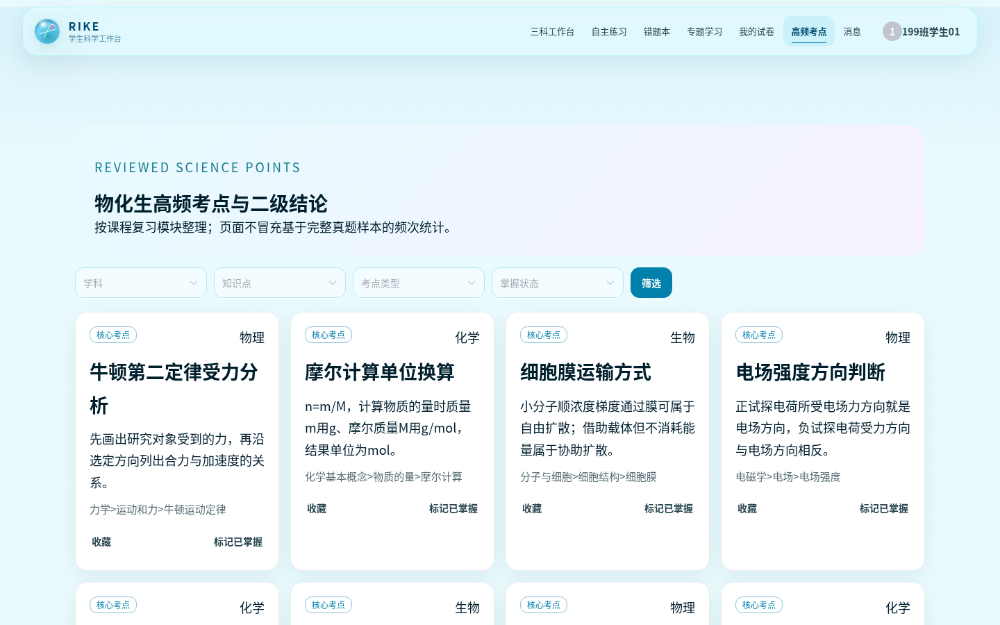</td>
</tr></table>

### 教师

| 功能 | 说明 |
|---|---|
| 任课工作台 | 只展示本人 ACTIVE 任课范围内的班级、学生与学情统计，不做排名 |
| 高频考点 | 为任课班级维护考点，学生端同步可见 |
| 组卷与发布 | 手动或按规则组卷（规则组卷只抽可自动判分题），生成学生版 / 答案版并可打印；发布到本人任课班级 |
| 作答统计 | 查看班级提交情况、逐题统计与学生画像，弹窗内定时同步新提交 |
| 班级私有题库 | 在任课范围内新建、导入、编辑并发布只对该班级可见的题目 |
| AI 候选题审核 | 审核 AI 生成的变式候选题，通过后才进入题库 |

### 管理员

| 功能 | 说明 |
|---|---|
| 系统总览 | 账号、班级、题库与待办概况 |
| 班级 / 学生 / 教师 | 班级管理、学生管理与 Excel 批量导入、教师与任课关系、管理员角色授予 / 撤销 |
| 题库 | Excel 批量导入（Preview → Confirm）、审核发布、来源与权利信息维护、图片附件 |
| AI 模型管理 | 配置文本 / 视觉模型、连接测试、启停与默认模型；密钥只回显“是否已配置” |
| 密码恢复 / 操作日志 | 处理用户密码恢复申请；检索管理员高风险操作日志 |

<table><tr>
<td>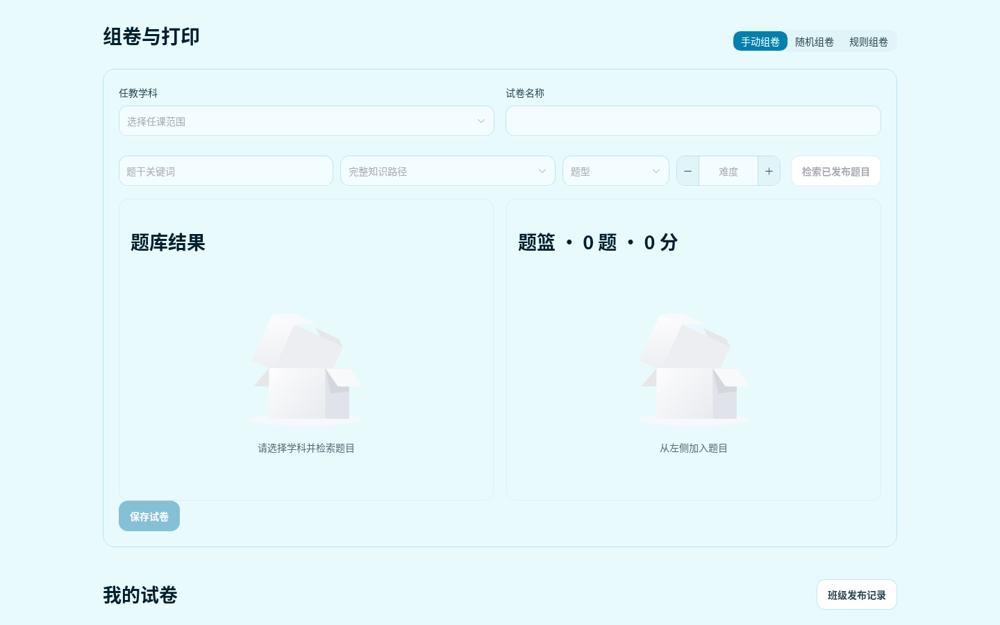</td>
<td>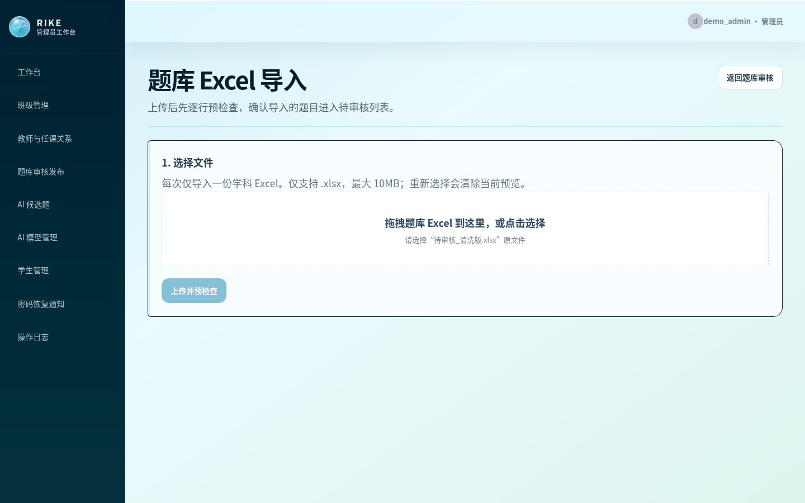</td>
<td>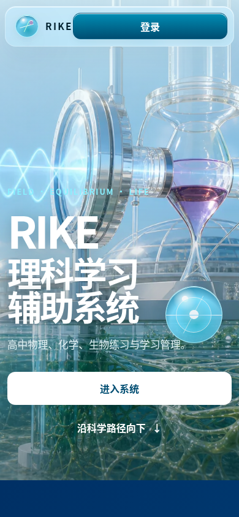</td>
</tr></table>

## 适用场景

- **学校 / 年级组的理科日常练习**：老师按班级组卷发布，学生课后在线完成，系统自动统计客观题。
- **个人或学习小组刷题复盘**：按知识点练习、错题再做，配合知识卡片查漏补缺。
- **教研题库建设**：通过 Excel 批量导入并逐题审核，沉淀带来源与权利信息的结构化题库。
- **教学软件 / 课程项目参考**：一套前后端分离、权限与审计完整、带 AI 接入边界设计的 Spring Boot + Vue 实战样例。

## 为什么是 RIKE

| | 通用问卷 / 表单工具 | 直接用 AI 聊天刷题 | RIKE |
|---|---|---|---|
| 理科公式与化学式 | 弱 | 依赖模型输出 | KaTeX + mhchem 原生渲染 |
| 判分依据 | 人工设置 | 模型自行判断，可能出错 | 人工审核的标准答案，确定性判分 |
| 班级与权限 | 无 | 无 | 三元任课关系 + 服务端鉴权 |
| 错题与掌握度 | 无 | 需手动整理 | 自动沉淀，支持筛选 / 再做 / 推荐 |
| AI 的角色 | 无 | 全权 | 讲解与候选生成，不碰正式成绩 |
| 部署 | SaaS | SaaS | 自托管，数据留在本地 |

## 系统架构

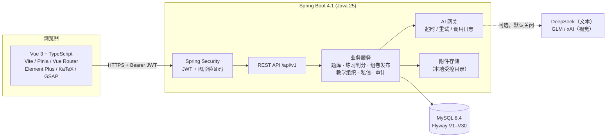

- **鉴权**：JWT 访问令牌 + 一次性图形验证码；角色与任课范围每次请求由服务端重新校验。
- **数据**：Flyway 是唯一的结构来源，已发布迁移不可修改；演示数据由独立命令写入 `rike_tiku_demo`，不随应用启动写入。
- **AI 边界**：AI 默认关闭；启用后只返回解释、答疑与 PENDING 状态的候选题，调用记录写入日志表。

| 层 | 技术 |
|---|---|
| 前端 | Vue 3.5、TypeScript 6、Vite 8、Pinia、Vue Router、Element Plus、Axios、KaTeX（mhchem）、GSAP、Vitest |
| 后端 | Spring Boot 4.1、Java 25、Spring Security、MyBatis-Plus、JdbcTemplate、Flyway 12、JJWT、Apache POI、springdoc-openapi |
| 数据库 | MySQL 8.4（utf8mb4 / utf8mb4_0900_ai_ci） |
| 工具 | Maven、npm、GitHub Actions、Python（离线题库整理工具） |

## 快速开始

### 环境要求

JDK 25 · Maven 3.9+ · Node.js 22+（推荐 24） · MySQL 8.4

### 1. 创建数据库

```sql
CREATE DATABASE rike_tiku_demo DEFAULT CHARACTER SET utf8mb4 COLLATE utf8mb4_0900_ai_ci;
```

### 2. 构建后端并写入演示数据

```bash
cd rike-tiku-backend
mvn -DskipTests package

export RIKE_TIKU_DB_NAME=rike_tiku_demo
export RIKE_TIKU_DB_PASSWORD='你的MySQL密码'
export RIKE_TIKU_JWT_SECRET="$(openssl rand -hex 32)"   # 至少 32 字节

# 执行 Flyway 迁移并写入演示数据（只会写入名称安全的演示库）
java -Dloader.main=com.riketiku.demo.DemoEnvironmentCommand \
     -cp target/rike-tiku-backend-1.0.0.jar org.springframework.boot.loader.launch.PropertiesLauncher \
     --demo.action=seed --server.port=0
```

> Windows 可直接使用 `.\scripts\demo-environment.ps1 acceptance-prepare`，详见 [演示环境](docs/DEMO_ENVIRONMENT.md)。

### 3. 启动后端

```bash
java -jar target/rike-tiku-backend-1.0.0.jar     # http://localhost:8081，健康检查 /api/v1/health
```

### 4. 启动前端

```bash
cd ../rike-tiku-frontend
npm ci
echo "VITE_API_BASE_URL=http://localhost:8081/api/v1" > .env.local
npm run dev                                      # http://localhost:8080
```

打开 `http://localhost:8080`，点击“登录”，使用下方演示账号即可。

### 主要环境变量

| 变量 | 默认值 | 说明 |
|---|---|---|
| `RIKE_TIKU_DB_HOST` / `_PORT` / `_NAME` | `localhost` / `3306` / `rike_tiku` | 数据库连接 |
| `RIKE_TIKU_DB_USERNAME` / `_PASSWORD` | `root` / 空 | 数据库账号 |
| `RIKE_TIKU_JWT_SECRET` | 空（必填） | JWT 签名密钥，至少 32 字节 |
| `RIKE_TIKU_BACKEND_PORT` | `8081` | 后端端口 |
| `RIKE_TIKU_CORS_ALLOWED_ORIGINS` | `http://localhost:8080` | 允许的前端来源 |
| `RIKE_TIKU_DEFAULT_RESET_PASSWORD` | `a1234567` | 新建 / 导入 / 重置账号的默认密码（使用它登录时会被要求修改） |
| `RIKE_TIKU_AI_ENABLED` 等 | `false` | AI 相关配置，见 [AI Provider 配置](docs/AI_PROVIDER_CONFIGURATION.md) |

## 演示账号

初始密码均为 `a1234567`，首次登录会要求修改密码。

| 角色 | 账号 |
|---|---|
| 管理员 | `demo_admin` |
| 管理员 + 教师（登录时选择角色） | `demo_physics_admin` |
| 教师 | `demo_teacher`、`demo_biology_teacher`、`demo_chemistry_teacher` |
| 学生 | `demo_student`、`demo_199_01` ~ `demo_199_05`、`demo_200_01` ~ `demo_200_03` |

演示题库为三科各 120 道项目自编客观题 + 15 个专题单元，详见 [演示环境](docs/DEMO_ENVIRONMENT.md)。

## 项目结构

```text
rike-tiku/
├─ rike-tiku-backend/      # Spring Boot 后端（Flyway 迁移位于 src/main/resources/db/migration）
├─ rike-tiku-frontend/     # Vue 3 前端
├─ database/               # 结构快照与 ER 图
├─ docs/                   # 设计、接口、数据库与运维文档、截图
├─ question-bank/          # 题目导入的受控来源根（本地题库数据不入库）
├─ tools/question-pipeline/# 离线题库整理工具（Python）
└─ scripts/                # 演示环境、模板生成、结构文档生成等脚本
```

## 测试

```bash
cd rike-tiku-backend  && mvn verify                                       # 需要可连接的 MySQL 8.4
cd rike-tiku-frontend && npm run type-check && npm test && npm run build
cd tools/question-pipeline && python -m unittest test_parser.py
```

## 常见问题

<details>
<summary><b>启动报 <code>Access denied ... (using password: NO)</code>？</b></summary>

后端进程没有拿到 `RIKE_TIKU_DB_PASSWORD`。请在启动后端的同一个终端或 IDE 运行配置中设置环境变量；项目不会自动读取 `.env` 文件。
</details>

<details>
<summary><b>演示账号登录后提示必须修改密码？</b></summary>

这是预期行为：使用系统默认密码登录的账号都必须先改密。改完后用新密码登录即可；重新执行演示 `seed` 会恢复初始密码。
</details>

<details>
<summary><b>前端能打开但所有请求都失败 / 跨域报错？</b></summary>

确认 `VITE_API_BASE_URL` 包含 `/api/v1`，并且后端的 `RIKE_TIKU_CORS_ALLOWED_ORIGINS` 与前端实际地址（含端口）完全一致。
</details>

<details>
<summary><b>不配置 AI 能用吗？</b></summary>

可以。AI 默认关闭，练习、判分、组卷、管理等全部核心功能都不依赖 AI。需要时在“AI 模型管理”中配置 DeepSeek / GLM / xAI 并启用。
</details>

<details>
<summary><b>能用 MariaDB 或 MySQL 5.7 吗？</b></summary>

不建议。迁移脚本使用了 MySQL 8 的 CHECK 约束变更、`utf8mb4_0900_ai_ci` 排序规则等特性，MariaDB 无法执行全部迁移。请使用 MySQL 8.4。
</details>

<details>
<summary><b>从 0.x 升级后启动报 Flyway 校验和不一致？</b></summary>

1.0.0 调整了 V14 迁移中的注释文字，已有数据库需要刷新一次校验和，见 [CHANGELOG 升级说明](CHANGELOG.md#100---2026-10-11)。
</details>

<details>
<summary><b>仓库里的题目可以随便用吗？</b></summary>

代码按 MIT 开源；演示题目为项目自编。内容来源与使用边界见 [CONTENT_NOTICE](CONTENT_NOTICE.md)。如有侵权请联系删除。
</details>

## 路线图

- [ ] Docker Compose 一键部署（MySQL + 后端 + 前端）
- [ ] 主观题教师在线批改与评语
- [ ] 学情报表导出（班级 / 个人，PDF / Excel）
- [ ] 题目相似度检测与去重提示
- [ ] 更多 AI Provider 适配与本地模型支持
- [ ] 英文界面（i18n）

## 参考资料

- Corbett, A. T., & Anderson, J. R. (1995). *Knowledge tracing: Modeling the acquisition of procedural knowledge.* User Modeling and User-Adapted Interaction. [doi:10.1007/BF01099821](https://doi.org/10.1007/BF01099821)
- Cepeda, N. J., et al. (2006). *Distributed practice in verbal recall tasks: A review and quantitative synthesis.* Psychological Bulletin. [doi:10.1037/0033-2909.132.3.354](https://doi.org/10.1037/0033-2909.132.3.354)
- Roediger, H. L., & Karpicke, J. D. (2006). *Test-enhanced learning.* Psychological Science. [doi:10.1111/j.1467-9280.2006.01693.x](https://doi.org/10.1111/j.1467-9280.2006.01693.x)
- Dunlosky, J., et al. (2013). *Improving students' learning with effective learning techniques.* Psychological Science in the Public Interest. [doi:10.1177/1529100612453266](https://doi.org/10.1177/1529100612453266)
- 教育部.《普通高中课程方案和语文等学科课程标准（2017年版2020年修订）》. [moe.gov.cn](http://www.moe.gov.cn/srcsite/A26/s8001/202006/t20200603_462199.html)
- [Spring Boot 官方文档](https://docs.spring.io/spring-boot/index.html) · [Vue 3 中文文档](https://cn.vuejs.org/guide/introduction.html) · [Flyway 文档](https://documentation.red-gate.com/flyway) · [MySQL 8.4 参考手册](https://dev.mysql.com/doc/refman/8.4/en/) · [KaTeX 支持的函数](https://katex.org/docs/supported.html) · [RFC 7519: JSON Web Token](https://www.rfc-editor.org/rfc/rfc7519)

## 参与贡献与许可

欢迎提交 Issue 与 PR，请先阅读 [贡献指南](CONTRIBUTING.md)；安全问题请按 [安全策略](SECURITY.md) 私下报告。

代码以 [MIT License](LICENSE) 发布，© 2026 Fiesty-Abyss。题库与内容说明见 [CONTENT_NOTICE](CONTENT_NOTICE.md)。
